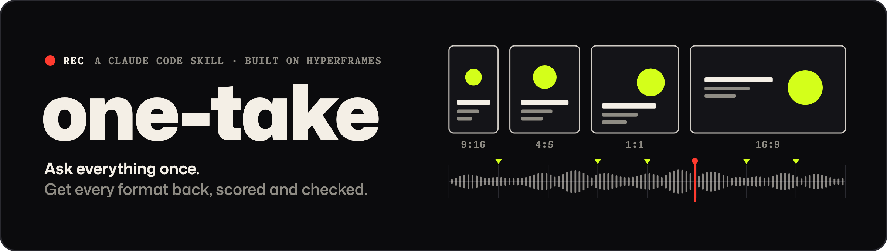

<div align="center">
  
</div>

# one-take

`one-take` is a skill for Claude Code (and any agent that reads `SKILL.md`) that turns "make a promo for this" into finished video files. Here's how a run goes:

1. It looks at your repo and site first: README, git history, logo, fonts, colours.
2. It asks one round of questions with the defaults already filled in.
3. Then it does the rest with no more questions:
   - storyboard
   - build
   - an original score with sound effects synced to the motion
   - a render for every aspect ratio and language you picked
   - a QA pass on every file
   - a report

It runs on [HyperFrames](https://github.com/heygen-com/hyperframes), which turns HTML into video, and adds what a finished deliverable needs:

| | |
|---|---|
| **One intake** | Formats, length and platform caps, scenes, references, sources, languages, sound, voice and captions, brand, all in one message. After that it only stops for a real blocker. |
| **Facts from git** | Commits, span, active days, busiest day, lines by language. Computed, never typed in. |
| **Sound that follows the picture** | Every motion that should be heard logs a cue at the frame it happens. A dependency-free synth builds stems (bed, band, drums, fx) on the film's bar grid. Sound effects are tuned to the chord under them and panned to where they happen on screen. Mastered to −14 LUFS. Nothing to license. Your own track works too. |
| **One source, every format** | 4:5, 9:16, 16:9 and 1:1, each re-laid out (not just rescaled), with the platform's UI bands as safe zones. Cutdowns drop optional scenes, never speed anything up. |
| **QA on every file** | Size, fps, duration, platform cap, loudness and true peak, black, frozen and silent stretches, an end card held 3 s or more, text big enough to read on a phone, text inside the safe zone, HyperFrames lint and contrast, plus a contact sheet to look at. |

## Requirements

- Node.js 22 or newer, and ffmpeg/ffprobe on `PATH`
- The HyperFrames skills: `npx skills add heygen-com/hyperframes`
- Chrome for the probe: HyperFrames downloads a headless Chrome on first use (`npx hyperframes doctor`), or set `CHROME_PATH`
- Network on the first run: `npx` fetches HyperFrames 0.8.223 and the build fetches GSAP 3.14.2. Both are cached after that.

There are no npm or Python packages to install.

## Install

Clone into your skills folder:

```bash
git clone https://github.com/KaranO-Dev/one-take-skill.git ~/.claude/skills/one-take
```

Then check the toolchain:

```bash
node ~/.claude/skills/one-take/scripts/selftest.mjs
```

The self-test confirms Node, ffmpeg and Chrome are present. It also builds a file designed to fail and checks that QA catches every problem planted in it.

## Use

In Claude Code, from the repo you want a video about:

> make a 30 second launch video for this, 4:5 and 9:16

The agent shows an intake sheet filled in from your repo, asks four questions (formats, length, sound, voice and captions), and then works through to the report. The project lands in `videos/<slug>/`:

```
videos/tally-launch/
  take.json          the whole spec (formats, scenes on a bar grid, sound, QA targets)
  BRIEF.md           HyperFrames-compatible, so /hyperframes resumes rather than re-asks
  STORYBOARD.md      direction and the scene table
  facts.json         numbers from git
  copy/en.json       every line of on-screen text
  src/index.html     the one source composition
  out/<format>-<lang>/   generated HyperFrames projects, with probe.json, cues.json, score/stems/
  renders/           <slug>-<format>-<lang>.mp4, .cover.jpg, .sheet.jpg, .qa.json
  REPORT.md
```

## Run the pipeline yourself

```bash
node scripts/detect.mjs <repo>                       # what's there
node scripts/facts.mjs --repo <repo> --out facts.json
node scripts/run.mjs <project> --draft               # fast pass: build, probe, score, check, render, encode, QA, report
node scripts/run.mjs <project>                       # final quality
node scripts/run.mjs <project> --only 9x16-en        # just one output
node scripts/score.mjs --analyze song.mp3            # bpm and first beat of your own track
```

Each step is its own script (`build`, `probe`, `score`, `encode`, `qa`, `report`) and can be run alone. See `SKILL.md` for the phases and `references/` for the details:

- `intake.md`: the sheet, the four questions, defaults, platform caps
- `take-json.md`: the spec
- `direction.md`: how to keep it from looking like a template
- `sound.md`: cue categories, the arrangement, levels, using your own music
- `formats.md`: multi-format builds, safe zones, cutdowns
- `qa.md`: every check and its threshold
- `kit.md`: the motion helpers (`T.rise`, `T.count`, `T.iris`, `T.cursor`, `T.cue` …)

## How the sound stays in sync

The composition calls `T.cue('click', t)` next to the tween that makes the click. Most helpers do this themselves: `T.count` cues one tick per visible change of the number, and `T.type` cues one key per character.

Before rendering, `probe.mjs` opens each build in headless Chrome, collects every cue, and resolves where on screen each one happens. `score.mjs` writes the music to the same bar grid the scenes are cut on, plays the cues over it, and masters the result. If you move a tween, the sound moves with it on the next run.

## Notes

- **GSAP** 3.14.2 is fetched once from jsDelivr at build time and cached in `~/.cache/one-take/`. The file is checked against a pinned sha256 after download and each time it is read from the cache. A file that doesn't match is never used: a bad download isn't cached, and a bad cached file is deleted and the build stops. Run it again to fetch a fresh copy. GSAP is used under its own licence, which is free for this use. It isn't redistributed in this repo.
- **HyperFrames** runs at the version pinned as `HF_VERSION` in `scripts/lib/platforms.mjs` (0.8.223), for `check`, `render` and the generated `package.json`. Set `hyperframes` in `take.json` to use another.
- **Names.** Languages, format ids, the slug and `output.name` must match `[a-z0-9][a-z0-9._-]{0,63}` (any case, no `..`). They become folder and file names, so a bad value stops the run before anything is rendered.
- **Render time** depends on HyperFrames and your machine. On an Apple Silicon laptop, a 26 s film in 4:5 and 9:16 took 87 s for the whole draft run and 110 s at high quality. CSS 3D and 60 fps cost more.
- **Platform caps and UI bands** (`scripts/lib/platforms.mjs`) are defaults. Platforms change them, and any value in `take.json` wins.
- **Publishing.** The skill never publishes, uploads or posts on its own. Renders are authorised by the intake. Everything after that is your call.

## Licence

MIT. See `LICENSE`.

Made by Karan Oroumchi, [karano.me](https://karano.me).
